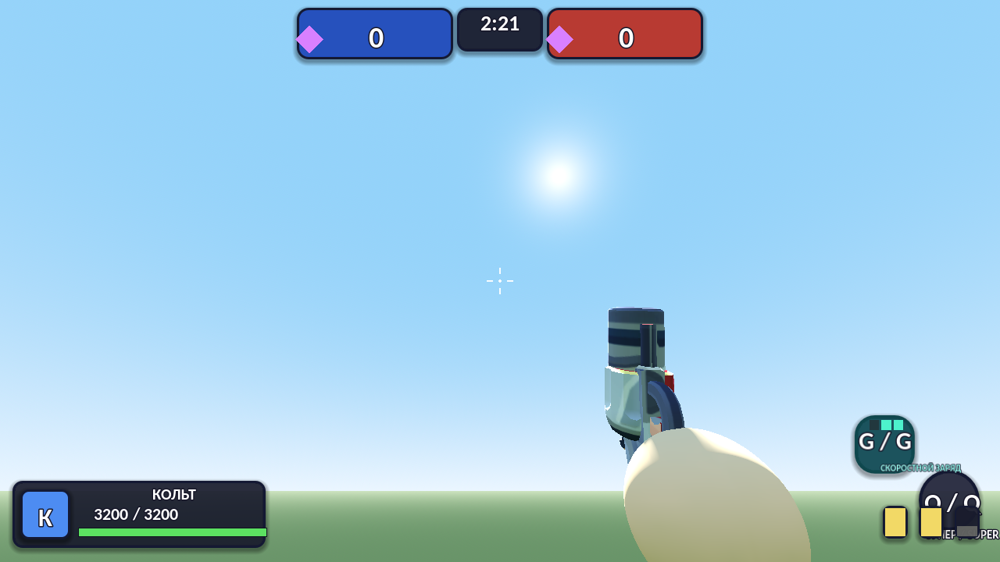
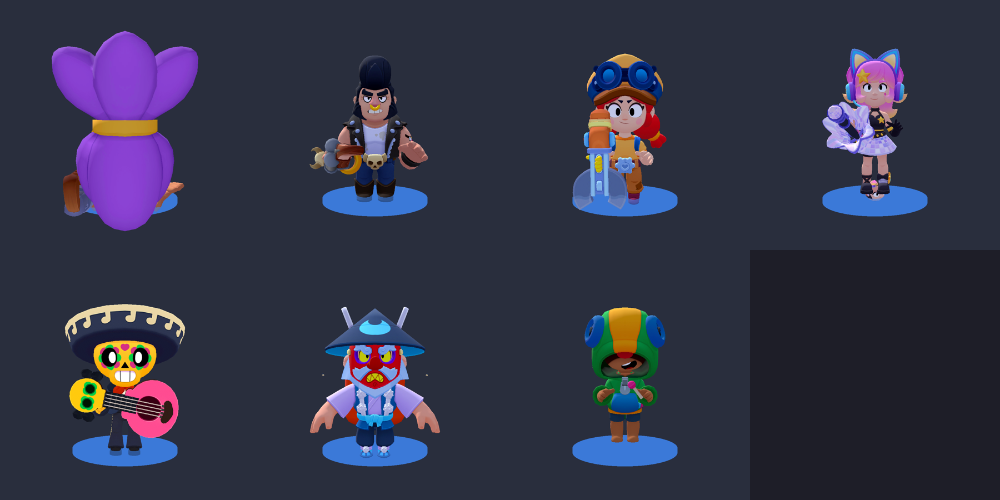
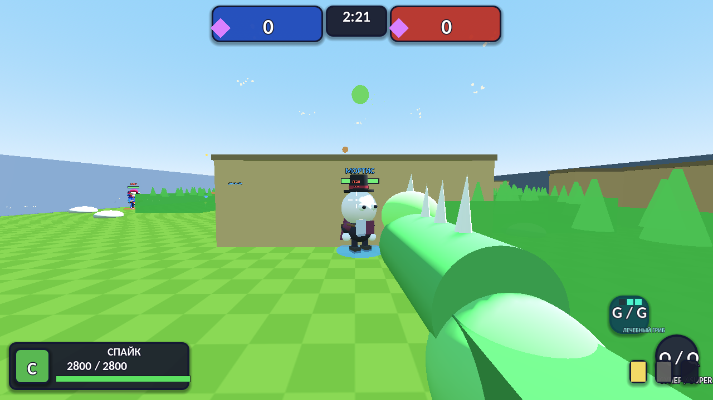

# BRAWL ARENA FPS

Фан-игра в стиле Brawl Stars **от первого лица** на движке **Godot 4**.

> ⚖️ **Дисклеймер:** бесплатная некоммерческая фан-игра, не связанная с Supercell.
> Ассеты бойцов используются в рамках [Fan Content Policy Supercell](www.supercell.com/fan-content-policy).
> *This material is unofficial and is not endorsed by Supercell.*

## ⬇️ Установка (Windows)

Скачай **`BrawlArenaSetup.exe`** со страницы **[Releases](https://github.com/bardanos1va-ui/brawl-arena-fps/releases/latest)** и запусти.

- Установщик сам проверит версию на сервере: если есть новее — скачает и поставит именно её, иначе поставит встроенную (офлайн-режим работает).
- Ярлыки появятся на рабочем столе и в меню «Пуск»; удаление — «Параметры → Приложения» или `Uninstall.bat` в папке игры.
- SmartScreen может предупредить о файле без цифровой подписи: **«Подробнее» → «Выполнить в любом случае»** — это нормально.

Без установщика: распакуй `BrawlArenaFPS_v2.17_Windows.zip` в любую папку и запусти `BrawlArenaFPS.exe`.

## 🔄 Автообновление

Игра и установщик проверяют версию на этом репозитории (GitHub Releases):

- **Установщик** при запуске: сервер новее встроенной версии → скачает zip новой версии (md5-контроль), иначе поставит встроенную.
- **Игра** при запуске меню: нашлась новая версия → в правом верхнем углу появляется оранжевая кнопка **«СКАЧАТЬ v…»** → игра скачивает установщик с прогрессом → обновляет игру (старая версия остаётся в `backups\`) → перезапускается.
- Приоритет адреса сервера: аргумент `--server` → `update_server.txt` рядом с exe → адрес, вшитый при сборке.

## 🎮 Игровой процесс

| Режим | Описание |
|---|---|
| **Захват кристаллов** | 3 vs 3: собери 10 кристаллов и удержи 15 секунд |
| **Шоудаун** | 10 бойцов, каждый сам за себя; ядовитый газ сжимает арену |
| **Мультиплеер** | по локальной сети / прямому IP, до 8 игроков (хост создаёт игру, друзья подключаются по IP:25565) |

- **8 бойцов** с механиками как в Brawl Stars: суперы, гаджеты (клавиша G, 3 заряда), звёздные силы
- Боты с 3 уровнями сложности: обход стен, стрельба с опережением, применение гаджетов
- Кусты для скрытности, разрушаемые стены, регенерация HP вне боя

| Действие | Клавиши |
|---|---|
| Движение / прыжок | **WASD** / **Пробел** |
| Стрельба | **ЛКМ** (удерживай) |
| Супер | **Q** или **ПКМ** |
| Гаджет | **G** |
| Пауза / полный экран | **ESC** / **F11** |

## 🧙 Бойцы

Шелли (дробовик), Кольт (очередь пуль), Пайпер (урон растёт с дистанцией), Булл (двустволка + рывок), Динамайк (броски шашек через стены), Поко (волна нот сквозь врагов + лечение), Леон (клинки + невидимость), Джесси (цепной разряд + турель).

## 📜 История версий

- **v2.17** — exe-установщик `BrawlArenaSetup.exe` + полный цикл автообновления (проверка версии на сервере, скачивание, бэкап, откат), сервер обновлений на GitHub Releases
- **v2.0** — мультиплеер по LAN/прямому IP; фиксы границ карт и крепления оружия; меню в стиле Brawl Stars
- **v1.9** — кастомные модели всех 8 бойцов, оружие из моделей
- **v1.4** — гаджеты и звёздные силы
- **v1.0–v1.3** — первые релизы, механики Brawl Stars, голоса персонажей
